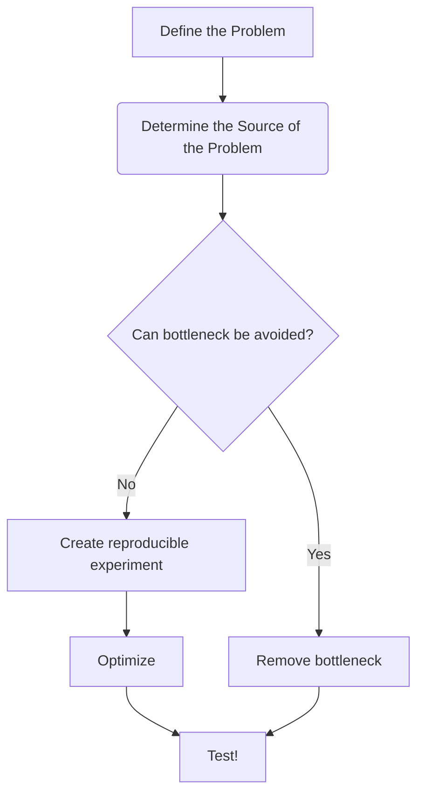

Open a todo-list with one entry per phase before launching anything

1. Define the Problem [[SKILL#1. Define the problem]]
2. Determine the source of the problem ([[SKILL#2. Locate problem]])
3. Determine whether bottleneck (=the source) can be avoided
4. Create reproducible experiment [[SKILL#4. Create reproducible experiment]]
5. Fix the problem
6. Test the fix! (verify correctness)

## 1. Define the problem

Define a goal. Aim to define something clearly desirable and meaningful.
Focus on impact to the end user.

Define success, including:

- how to measure
- what metric
- which workload
- what platform

Define multiple levels of success:

- ideal target
- acceptable target
- minimum target

Work together with your user to lock in the requirements.

When a choosen metric is the _mean_ **always** report the _stddev_ as well!

## 2. Locate problem

Reproduce the reported issue and perform profiling.
**Do not guess which parts are slow, verify with measurements!**

## 3. Determine whether bottleneck can be avoided

See if the work that takes a long time really needs to be done, or can be avoided.
Legacy software especially prune to this, because it may have been optimized for a different hardware.

If the problem can be avoided jump to step 6

## 4. Create reproducible experiment

If you have to perform optimization, first make sure there is a reproducible experiment or benchmark.
Start by running this experiment on the original code to establish the baseline.

Try to isolate external variables, such as disk or network latency.

Make sure to measure multiple times, don't take a single measurement as fact.

Experiments must be repeatable with just one command. Make sure there is a script that can build and setup every dependency and run the experiment with no user interaction.

## 5. Fix the problem

Create an optimization log. Test ideas against the repeatable experiment until the target performance has been reached.
For each optimization attempt record the idea and the outcome as well. Both for successful and unsuccessful trials.
Cross reference this document when designing new optimization attempt.

Record the baseline as the first entry in the optimization log.

Dispatch a separate subagent for each experiment. They should:

- design the new candidate
- implement the new candidate
- run the experiment
- record results
- if performance is acceptable based on [[SKILL#1. Define the problem]], stop

Perform at most N trials, where N is set by the user. If unspecified do at most 10 iterations.

## 6. Test the fix

Make sure the performance fix does not introduce a functional regression.

## Report

When you're done report what was done, how the metrics compare before and after and show the optimization log as well.
If in a git repo, commit your final version.
